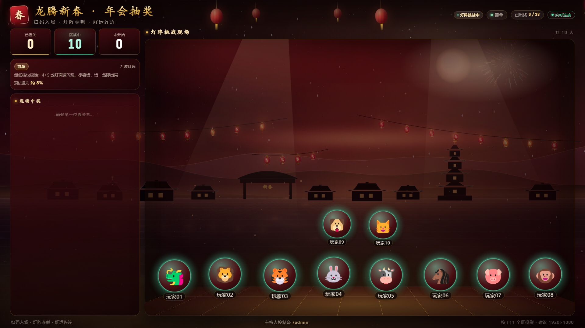

# 🏮 新春年会抽奖系统 · 灯阵·连击

一套**局域网即开即用**的春节年会抽奖系统：主机运行后即刻成为主服务器，大屏投影展示，观众用手机扫码（或输入 6 位房间号）进入，玩一局「灯阵·连击」记忆挑战——**通关即中奖**，奖品、人数、难度全部可在后台实时调配。

- 画风：中国红 + 鎏金夜宴，程序化 **2.5D**（透视舞台、多层视差、体积光、雪花烟花），无任何外链资源，断网可用。
- 架构：单进程 Node.js（**零框架**），HTTP + SSE 实时同步，无数据库，状态落盘 `data/state.json`。
- 终端：大屏（`/`）、手机端（`/play`）、后台（`/admin`）三端同源。



---

## 1. 快速开始

**运行环境**：Node.js ≥ 18（推荐 20/22/24），Windows / macOS / Linux。

**克隆后首次运行**：安装唯一依赖 `qrcode`（用于生成入场二维码）。

```powershell
git clone https://github.com/LiZhiYi7/cny-lantern-lottery.git
cd cny-lantern-lottery
npm install        # 只需一次；Windows 双击 start.bat 时也会自动安装
npm start
```

> 离线现场：先在一台能联网的机器 `npm install`，再把整个目录（含 `node_modules`）拷到现场电脑，可完全离线运行。

**Windows（推荐）**：双击 `start.bat`（会自动安装依赖并启动）。**macOS / Linux**：`npm start`（等价于 `node server.js`）。

启动后控制台会打印：

```
🏮  新春年会抽奖系统 已启动
大屏（投影本机） :  http://192.168.1.8:8080/
手机端（扫码）   :  http://192.168.1.8:8080/play
后台管理         :  http://192.168.1.8:8080/admin
房间号           :  482913
后台密码         :  8888
```

| 页面 | 地址 | 用途 |
| --- | --- | --- |
| 大屏 | `http://<主机IP>:8080/` | 投影/大屏：房间号、二维码、玩家入场、实时进度、开奖 |
| 手机端 | `http://<主机IP>:8080/play` | 玩家扫码进入，输入昵称与 6 位房间号 |
| 后台 | `http://<主机IP>:8080/admin` | 奖品、人数、难度、开奖控制（默认密码 `8888`） |

> 现场建议：大屏页面按 `F11` 全屏；手机与大屏主机连**同一个 Wi-Fi/热点**。
> 首次启动 Windows 会弹防火墙提示，请允许「专用网络」访问，否则手机连不上。

---

## 2. 现场流程（5 步）

1. **布场**：主机接投影，打开大屏页面全屏；后台在另一标签页登录。
2. **配置**：后台设置奖品（名称/emoji/数量）、人数上限、难度、抽奖规则，确认标题。
3. **入场**：观众扫大屏二维码进 `/play`，填昵称、选头像，输房间号（大屏上有大字提示）。大屏实时弹出玩家头像。
4. **开赛**：后台点「开始游戏」→ 大屏 3-2-1 倒计时 → 所有人手机同时进入灯阵。
5. **开奖**：玩家通关即刻出奖（手机展示奖品、大屏烟花 + 中奖卡）；全员结束自动开奖，大屏展示全场中奖名单。需要加赛则「重置本轮」（会换新房间号）。

---

## 3. 玩法「灯阵·连击」

8 盏灯笼围成一圈，每一波：

1. **记忆**：灯笼按随机顺序依次亮起（`len` 盏，每盏亮 `showMs` 毫秒）。
2. **复现**：灯灭后计时开始，在 `inputMs` 内按**原顺序**点灯；点错一次即失败，超时失败。
3. 通过进入下一波，全部波次通过 → **中奖**。

玩法难度由「灯数 + 闪灯时长 + 输入时限 + 波数」共同决定，**最低档「简单」也是零容错、闪灯仅 480ms 的硬核档**。

| 档位 | 波次 | 序列长度 | 闪灯时长 | 预计通关率 | 说明 |
| --- | --- | --- | --- | --- | --- |
| 简单 | 2 | 4 → 5 | 460/420ms | 约 8% | 最低档也极难，零失误才通关 |
| 标准 | 2 | 5 → 6 | 380/340ms | 约 4% | 序列更长、节奏更快 |
| 困难 | 3 | 5 → 6 → 6 | 340/300/280ms | 约 2% | 三波连击，手抖出局 |
| 极致 | 3 | 6 → 7 → 7 | 280/240/220ms | 约 0.5% | 留给眼力与手速的王者 |
| 获奖 | 1 | 2 | 900ms | 必得奖 | 全员福气档：完成即得奖（按库存发放） |

> 「获奖」档适合开场热身或收尾发奖；库存发完后自动改发「新春福袋」安慰奖。
> 每档的**预估通关率**会在后台难度卡片上展示，仅为经验值，可按现场人群调档。

---

## 4. 后台功能

登录密码默认 `8888`（后台可改，改后不再回显）。

- **奖品管理**：新增 / 编辑 / 删除 / 改数量，实时显示「总量 / 已发 / 剩余」；支持恢复示例奖品。库存为 0 时不再发放。
- **玩家上限**：1–200 人，满员后加入会被拒绝并提示。
- **游戏难度**：5 档单选，卡片上直接标注玩法参数与预估通关率。
- **抽奖规则**：低价值优先（默认，压轴留大奖）/ 高价值优先 / 随机。
- **控制**：开始游戏、提前揭晓、重置本轮（换房间号、清空本轮玩家，保留库存与中奖名单）、清空中奖名单（不影响库存）。
- **玩家管理**：实时列表、踢人、手动发奖。
- **中奖名单**：实时同步，一键导出 CSV（Excel 可直接打开，UTF-8 BOM）。
- **开奖名单口径**：大屏开奖与后台名单展示的是**累计中奖名单**（跨轮保留，直到点「清空名单」）。如果晚会分多轮、每轮只想看本轮中奖者，请在开始下一轮前点一次「清空名单」（不影响库存）。

---

## 5. 数据、重置与备份

- 全部状态保存在 `data/state.json`：配置、奖品与已发放数量、中奖名单。**实时写入，重启不丢。**
- 换一场活动：后台「恢复示例奖品」+「清空中奖名单」+「重置本轮」即可；要彻底恢复出厂设置，停止服务后删除 `data/state.json`。
- 备份：直接复制 `data/state.json`。
- 「重置本轮」会更换房间号并清空本轮玩家，但**已发放库存与中奖名单会保留**，避免重复领奖。

### 环境变量

| 变量 | 默认 | 说明 |
| --- | --- | --- |
| `PORT` | `8080` | 服务端口 |
| `DATA_DIR` | `./data` | 状态文件目录 |
| `HOST_IP` | 自动探测 | 多网卡/虚拟网卡导致二维码地址不对时，强制指定局域网 IP |

```powershell
$env:PORT=9000; node server.js
$env:HOST_IP="192.168.1.8"; node server.js
```

---

## 6. 常见问题

**手机扫码打不开 / 一直转圈**
1. 手机和主机是否在同一 Wi-Fi（公司网络可能开启「AP 隔离」，可改用手机热点）。
2. Windows 防火墙是否放行 Node.js（专用网络）。
3. 大屏上的地址是否为 `192.168.x.x`；若显示 `127.0.0.1`，说明没探测到局域网 IP，用 `HOST_IP` 指定。

**端口被占用**：`$env:PORT=8081; node server.js`，并让手机访问同端口的地址。

**二维码不显示**：依赖缺失，执行 `npm install`（仅缺二维码，其它功能不受影响）。

**画面卡顿**：大屏用 Chrome/Edge 最新版；关闭其它占用 GPU 的窗口；低配机器可在 `art.js` 中降低密度（`quality:'low'` 已自动适配）。

**有人刷新了手机页**：会自动恢复身份；若在开赛倒计时/游戏中刷新，会以同一灯阵重新开始本局。

**主持人误操作「重置本轮」**：房间号会变，让观众重新扫码即可；库存与中奖名单不受影响。

---

## 7. 目录结构

```
server.js              主服务器：HTTP / SSE / 静态资源 / 后台 API / 二维码 / CSV
lib/
  difficulty.js        5 档难度参数（唯一数据源）
  room.js              房间、玩家、发奖、阶段状态机
  store.js             配置/奖品/中奖名单持久化（data/state.json）
  hub.js               SSE 连接池
  util.js              错误类型、局域网 IP、CSV 转义
public/
  index.html + css/host.css + js/host.js       大屏
  play.html  + css/player.css + js/player.js   手机端
  admin.html + css/admin.css + js/admin.js     后台
  js/art.js            2.5D 场景引擎（Canvas 程序化绘制）
  js/net.js            SSE + fetch 封装
  css/theme.css        设计系统（配色 / 组件 / 动效）
PROTOCOL.md            前后端接口契约（协作与二次开发参考）
tools/                 自动化冒烟 / 并发 / 浏览器验收脚本
docs/                  QA 验收报告与三端截图
data/state.json        运行数据（自动生成）
```

---

## 8. 设计说明

- **2.5D 表现**：背景 Canvas 分六层（夜空月晕 → 远山 → 村落宝塔 → 灯笼串 → 透视地砖/雪地 → 粒子与烟花），大屏玩家头像按行做景深缩放和软投影，奖品以 3D 展台呈现；所有图形均由代码实时绘制，无图片资源。
- **实时同步**：SSE 单向推送（服务端 → 三端），写操作走 HTTP POST；快照 60ms 合并推送，30+ 人同时在线依然轻量。
- **判定在服务端**：成绩提交会校验波次、命中数、失误数与理论最短耗时（防瞬时作弊），并做幂等处理，重复提交不会重复发奖。
- **离线优先**：无 CDN、无外部字体、无第三方统计；`node_modules` 仅含本地二维码生成。
- **自动化验收**：`node tools/smoke-test.js`（73 项 API/SSE/判定/安全断言）、`node tools/e2e-sim.js`（30 人并发压测）、`node tools/browser-qa.js`（三端浏览器截图与交互，需本机 Edge）。详细验收记录见 [`docs/QA.md`](./docs/QA.md)。

---

## 9. 二次开发

接口契约见 [`PROTOCOL.md`](./PROTOCOL.md)：包含完整数据模型、HTTP API、SSE 事件、难度参数、`art.js`/`net.js` 接口、文件所有权与验收清单。改难度只需编辑 `lib/difficulty.js`；换配色改 `public/css/theme.css` 顶部的 CSS 变量；自定义舞台美术改 `public/js/art.js`。

---

## 10. 界面预览

验收截图共 15 张，存放在 [`docs/screenshots/`](./docs/screenshots/)（Edge headless 实拍，1920×1080 / 1280×720 / 390×844 / 375×812）。

| 场景 | 截图 |
| --- | --- |
| 大屏 · 入场候场（房间号 + 二维码 + 2.5D 舞台） | [`host-lobby-1920.png`](./docs/screenshots/host-lobby-1920.png) |
| 大屏 · 灯阵挑战现场（进度 / 中奖浮层 / 舞台角色） | [`host-playing-1920.png`](./docs/screenshots/host-playing-1920.png) |
| 大屏 · 全场开奖（分组名单 + 烟花） | [`host-reveal-1920.png`](./docs/screenshots/host-reveal-1920.png) |
| 大屏 · 1280×720 投影适配 | [`host-lobby-1280.png`](./docs/screenshots/host-lobby-1280.png) |
| 手机 · 加入页 | [`player-join-390.png`](./docs/screenshots/player-join-390.png) |
| 手机 · 灯阵复现 | [`player-playing-390.png`](./docs/screenshots/player-playing-390.png) |
| 手机 · 中奖结算 | [`player-result-390.png`](./docs/screenshots/player-result-390.png) |
| 后台 · 总览 | [`admin-lobby-1920.png`](./docs/screenshots/admin-lobby-1920.png) |
| 后台 · 开奖名单 | [`admin-reveal-1920.png`](./docs/screenshots/admin-reveal-1920.png) |

> 截图由 `node tools/browser-qa.js` 自动生成；该脚本会自起服务、用 Edge 无头浏览器走完「加入 → 开赛 → 灯阵 → 中奖/未中奖 → 开奖 → 重置」全流程，并检查黑屏、溢出、外链、触控热区与断线重连。
