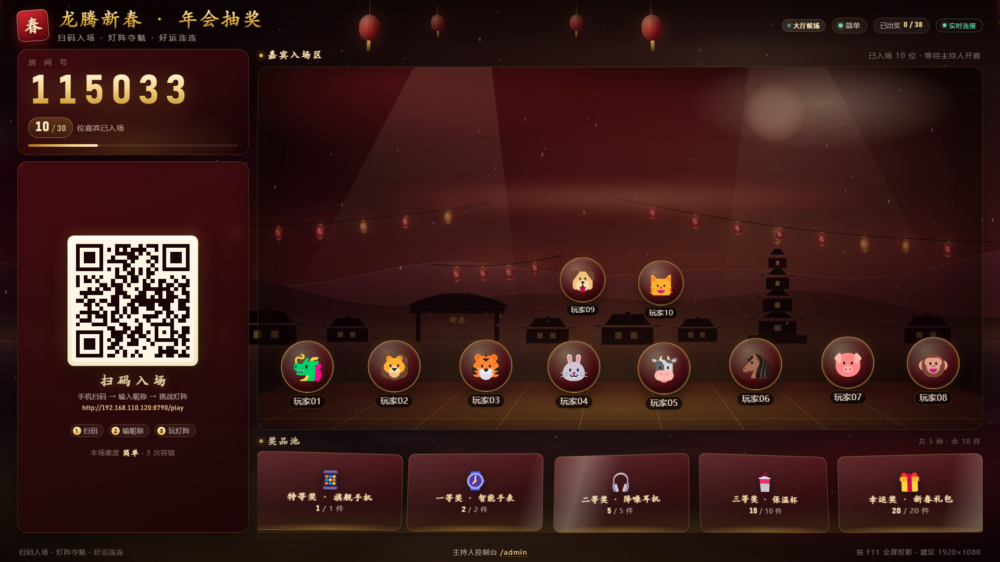
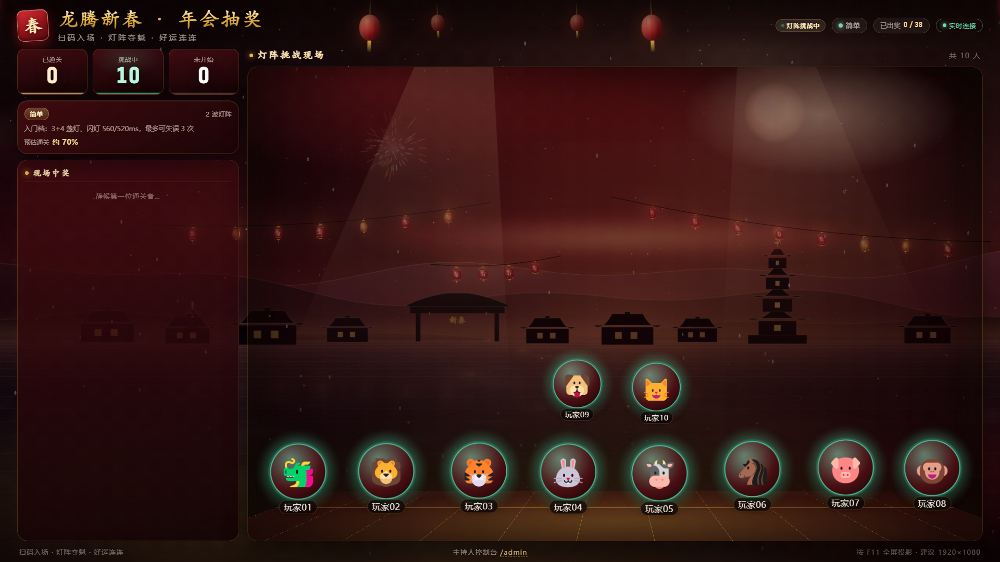
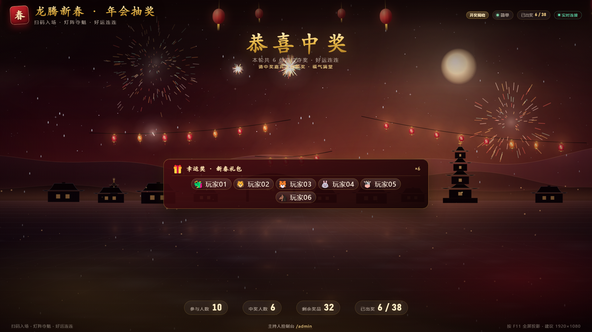
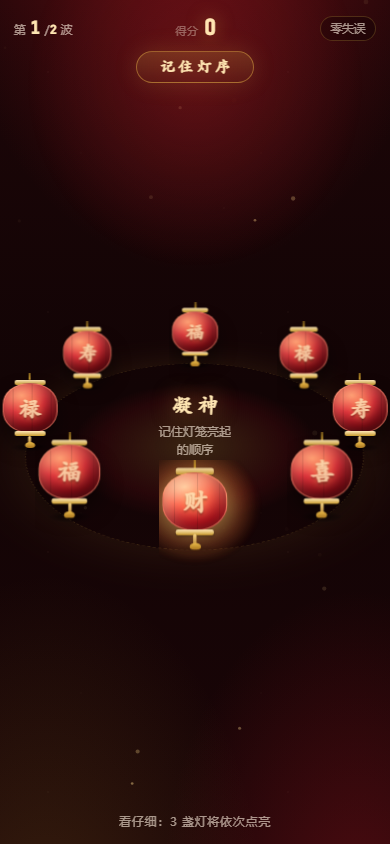
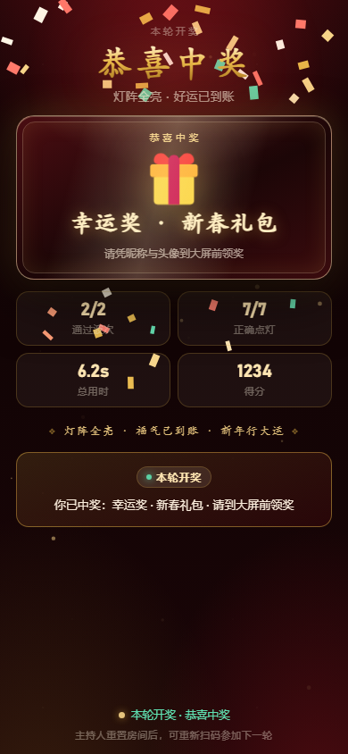
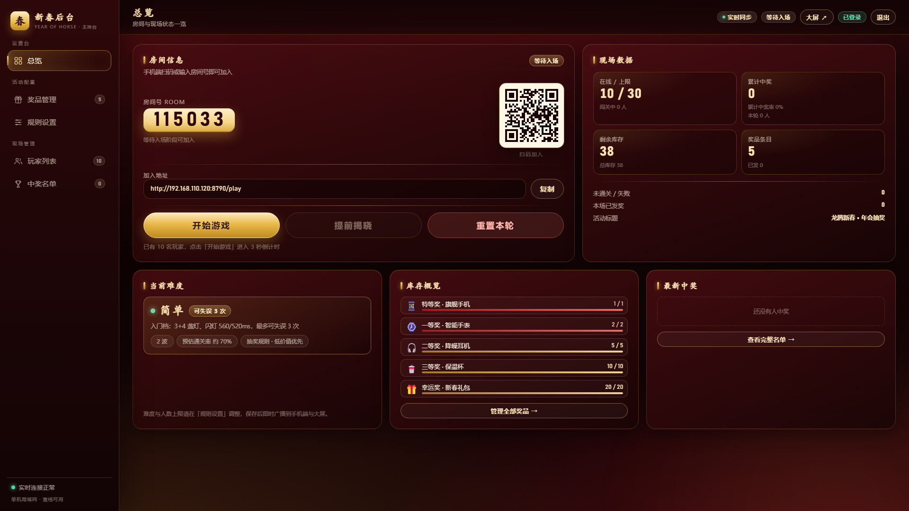

# 新春年会抽奖系统 · QA 验收报告

> 独立 QA 验收（第三方视角，只读写 `tools/`、`docs/`、`_tmp/qa/`，不修改 `server.js` / `lib/` / `public/`）。
> 验收依据：`PROTOCOL.md`（协作协议 v1，含 §2 难度、§4 API、§5 SSE、§6 判定、§12 验收清单）。
> 报告生成：2026-11-01 02:35（Asia/Shanghai） · 页面冻结版本（02:20）最终回归 · 自动化产物：`_tmp/qa/*.json`、`_tmp/qa/shots/`。

---

## 0. 结论摘要

| 维度 | 结果 |
| --- | --- |
| 服务端 API 冒烟（PROTOCOL §4/§5/§6/§12） | **73 / 73 通过**（`node tools/smoke-test.js`，0 失败 0 提示） |
| 30 人并发仿真（一致性/库存/福袋） | **14 / 14 通过**（`node tools/e2e-sim.js`） |
| 三端页面浏览器验收（Edge headless + CDP） | **26 / 26 通过**（`node tools/browser-qa.js`，15 张正式截图，逐张人工目视复核） |
| 局域网可访问性 | **通过**：`http://192.168.1.8:8790/api/health` → 200；`/`、`/play`、`/admin`、`/api/qr.svg` 走局域网 IP 均 200 |
| 正式 `data/` 污染 | **无**：三套脚本均使用 `_tmp/qa/` 下独立 `DATA_DIR`，运行前后项目 `data/` 目录状态一致（脚本内断言） |
| 未决阻塞问题 | **无 P0/P1/P2/P3 功能缺陷未决**；10 项问题中 8 项功能/页面缺陷已修复并复测通过，BUG-09 文档口径偏差、BUG-10 环境记录两个非缺陷项留存 |

**结论**：服务端与三端页面核心链路（加入 → 开赛 → 灯阵 → 中奖/未中奖 → 自动/手动开奖 → 重置）已可交付年会现场使用；QA 发现的 10 项问题中 8 项功能/页面缺陷全部修复并通过复测，2 项为非功能项（文档口径、headless 环境策略）已书面记录；额外复核了 3 项页面修复（后台累计口径、手机端 reset 回加入页、SSE 异常 4s 兜底重连）也全部通过。现场使用建议见 §9。

---

## 1. 测试环境与版本

| 项 | 值 |
| --- | --- |
| 操作系统 | Microsoft Windows 11 专业版 10.0.22621 / 64-bit |
| CPU / 内存 | Intel Core i7 / 24 GB |
| Node.js | v24.17.0（`win32 x64`） |
| 浏览器 | Microsoft Edge **156.0.4314.50**（headless=new，通过 CDP 驱动） |
| 第三方依赖 | `qrcode@1.5.4`（`node_modules` 已安装；未用其它依赖） |
| 被测服务 | `server.js` + `lib/*`（Lead 维护），页面 `public/index.html`、`public/play.html`、`public/admin.html` 及三端 CSS/JS |
| 被测端口 | **8790**（QA 专用；与 Lead 8080、host 8711、player 8712、admin 8713 隔离） |
| 测试机局域网 IP | 192.168.1.8（WLAN） |
| 数据目录 | `_tmp/qa/data`（smoke）/ `_tmp/qa/data-e2e`（并发）/ `_tmp/qa/data-shot`（截图），均独立于正式 `data/` |

---

## 2. 测试资产与一键运行（干净环境）

三套脚本均为**零第三方依赖** Node 脚本（除被测服务自身的 `qrcode`），**自己拉起被测服务、跑完自动关闭并清理**，不依赖任何已运行的服务。

| 脚本 | 作用 | 命令 |
| --- | --- | --- |
| `tools/smoke-test.js` | API/SSE/判定/安全 全量冒烟，覆盖率见 §4 | `node tools/smoke-test.js` |
| `tools/e2e-sim.js` | 30 人并发加入→开赛→60% 中奖并发提交→库存/名单/快照一致性→打空库存验福袋 | `node tools/e2e-sim.js` |
| `tools/browser-qa.js` | Edge headless 造 lobby/playing/award/reveal 三端截图 + JS 异常/外链/溢出/黑屏/触控热区/断线重连/reset 自动检测 | `node tools/browser-qa.js` |

运行约定：

```powershell
# 在项目根目录（C:\path\to\cny-lantern-lottery）执行
node tools/smoke-test.js      # 自起 8790，73 项断言；退出码 0 = 全绿
node tools/e2e-sim.js         # 自起 8790，14 项断言；退出码 0 = 全绿
node tools/browser-qa.js      # 自起 8790 + Edge headless（自动选空闲 CDP 端口），23 项检查 + 15 张截图
```

- 三个脚本**不要同时运行**（都使用 8790 自起服务；脚本启动时会检测端口占用并给出明确提示）。
- 自定义端口：`$env:QA_PORT=8795; node tools/smoke-test.js`（e2e/browser 同样支持）。
- 保留现场：`$env:QA_KEEP=1; node tools/smoke-test.js`（不删 `_tmp/qa/data`、保留 Edge profile）。
- `browser-qa.js` 依赖本机 Edge（自动探测 `C:\Program Files (x86)\Microsoft\Edge\Application\msedge.exe`），无需安装 Playwright；每个页面用独立 BrowserContext 隔离 localStorage/cookie，Edge 调试端口自动在 9411~9450 中挑选空闲值；只清理本次专用 `edge-profile-qa-*` 进程，不触碰其他 Edge。
- 结果落盘：`_tmp/qa/smoke-result.json`、`_tmp/qa/e2e-result.json`、`_tmp/qa/browser-result.json`；截图 `_tmp/qa/shots/`，正式截图副本见 `docs/screenshots/`。

---

## 3. PROTOCOL §12 验收清单逐项结果

| # | 验收项 | 结果 | 证据 |
| --- | --- | --- | --- |
| 1 | `node server.js` 打印大屏/手机端/后台地址与房间号 | ✅ | smoke A1（横幅含三端地址 + 6 位房间号，与 `session.roomCode` 一致） |
| 2 | 手机端错房间号明确报错；正确房号+昵称进入等待页，大屏实时出现该玩家 | ✅ | smoke B1/B4/N2（`BAD_CODE` 中文提示；join 后 host SSE 收到含该玩家的 `session`） |
| 3 | 后台加奖品/改数量/删除/改人数/切难度 → 大屏与手机端同步 | ✅ | smoke E1–E5、D2、D4、F1（后台写操作后 session 快照与 SSE `session` 同步；非法值全部 400） |
| 4 | 开始游戏 → 手机端 3-2-1 倒计时 → 灯阵可玩；大屏显示进度 | ✅ | smoke G3；浏览器截图 `player-countdown-390.png`（大号「2」+ 即将开始）、`player-playing-390.png`（8 盏灯笼环 + 复现提示 + 时限条）、`host-playing-1920.png`（通关/挑战中/未开始 + 现场中奖列表） |
| 5 | 通关 → 手机端立即显示奖品、大屏 `award` 动画、库存 -1 | ✅ | smoke H1/N3（`win=true`、`award` 事件、`prize.awarded+1`、`remaining-1`）；截图 `host-award-1920.png`、`player-result-390.png` |
| 6 | 全部完成自动 reveal；后台可提前揭晓、可重置（换房号） | ✅ | smoke I1（实测约 2.5s 自动 reveal）、I2（手动 reveal、未提交记 lost+`missed`）、L4（重置换房号清玩家、保留库存与中奖名单） |
| 7 | 人数满 / 游戏已开始 时加入 → 正确拒绝 | ✅ | smoke F1（`ROOM_FULL`，同 cid 仍幂等放行）、G4（`GAME_STARTED`） |
| 8 | 刷新手机页恢复身份；后台刷新保持登录 | ✅ | smoke G5（rejoin 返回同 pid + `game` 含 seed）、C4（登出失效/重登恢复）、N4（SSE 重连 hello+session）；Cookie `HttpOnly; SameSite=Lax` |
| 9 | 断网/离线：无外链请求；数据重启后保留 | ✅ | 浏览器脚本对 15 个页面态采集网络请求：**0 条外链**（CSP `default-src 'self'` 生效）；smoke O1（重启后 config/prizes/winners 保留，运行态归 lobby） |
| 10 | 375×812 与 1920×1080 两种尺寸无重叠/溢出，主要按钮可点 | ✅ | 1920×1080、1280×720、390×844、375×812 全部截图；375×812 纵向溢出问题已修复并复测（scrollHeight 826→812）；灯阵按钮热区 39×49→51×63 起；无横向溢出，主要按钮可点（截图 `player-join-375.png` 等） |

---

## 4. 自动化测试明细

### 4.1 服务端冒烟：73/73 通过（`node tools/smoke-test.js`）

> 脚本自起 `PORT=8790 DATA_DIR=_tmp/qa/data`，等待 `/api/health` 就绪后测试，结束 kill 并清理。每项失败会打印完整响应体并以退出码 1 结束。

**A. 启动与基础健康**
- ✅ A1 启动横幅打印大屏/手机端/后台地址与房间号
- ✅ A2 `/api/health` 返回 `ok/phase/players/uptime` 且端口为 8790
- ✅ A3 session 快照基础字段完整（§3.5）
- ✅ A4 session.difficulty 下发完整信息（§2/§5）

**B. 房间码与加入校验**
- ✅ B1 错误房间号 → 400 `BAD_CODE`（中文提示含「房间号」）
- ✅ B2 空昵称 / 全空格昵称 → 400 `BAD_NAME`
- ✅ B3 超长昵称（13 字 / 200 字）→ 400 `BAD_NAME`
- ✅ B4 正常加入：返回 `pid/token`，session 同步且**不泄露 token**
- ✅ B5 同 cid 重复加入 → 幂等同一玩家，不重复占位
- ✅ B6 昵称边界 12 字可加入；前后空白 trim
- ✅ B7 非法头像回退为合法 emoji（不报错）
- ✅ B8 `GET /api/state?cid=` 返回 `you`
- ✅ B9 加入缺少 cid → 400 `BAD_INPUT`

**C. 后台登录与权限**
- ✅ C1 未登录访问数据/写操作/导出 → 401 `UNAUTHORIZED`
- ✅ C2 错误 PIN → 401 `BAD_PIN`；正确 PIN → 200 + `HttpOnly` cookie
- ✅ C3 `admin/data` 结构完整、含 5 档难度、**不泄露 pin**（响应中无 `"pin"` 字段、无明文 8888）
- ✅ C4 logout 后 cookie 失效；重新登录恢复

**D. 配置修改**
- ✅ D1 非法配置值（人数/难度/规则/标题/副标题/PIN 共 15 组）全部 400 `BAD_INPUT`
- ✅ D2 合法配置即时生效并同步 session（人数/规则/标题/副标题/难度）
- ✅ D5 5 档难度由服务端下发且逐级加难（容错次数单调不增、总灯数单调不减；prize 保底 `maxStrikes=99`；参数以 `lib/difficulty.js` 为准）
- ✅ D3 修改 PIN 后当前登录会话保持有效（旧 PIN 失效、新 PIN 可登录）
- ✅ D4 修改标题后大屏通过 SSE 收到最新 `session`

**E. 奖品与库存**
- ✅ E1 新增奖品追加末尾并即时同步 session
- ✅ E2 奖品非法值（空名/超长/负数量/1000/1.5/字符串）→ 400；不存在 id → 404
- ✅ E3 修改名称/数量/emoji/备注生效，`remaining` 重算
- ✅ E4 删除奖品成功且 `order` 重排
- ✅ E5 `prize.reseed` 恢复 5 项示例奖品且 awarded 归零

**F. 人数上限**
- ✅ F1 达到 `maxPlayers` → 400 `ROOM_FULL`；满员时同 cid 仍幂等放行

**G. 开赛与 `game`**
- ✅ G1 无玩家开赛 → 400 `NO_PLAYERS`
- ✅ G2 reset 换房号、清玩家、保留奖品与中奖记录
- ✅ G3 开赛 `phase=playing`、`sessionId`、`startAt≈now+3200ms`；SSE `game` 事件含 `seed/startAt/waves/maxStrikes/minMs`，`minMs` 与各波理论最短耗时一致
- ✅ G4 开赛后加入 → 400 `GAME_STARTED`
- ✅ G5 开赛后 rejoin 恢复身份（返回 `game` 供灯阵序列恢复）；错误 token → 403 `BAD_TOKEN`

**H. 成绩判定（§6）**
- ✅ H1 全通过 → 中奖、库存 -1、`stats.wins` / `winners` / `winner.difficulty` 一致
- ✅ H2 重复提交 → `duplicate:true`，不重复发奖、不新增名单
- ✅ H3 错一步 → 未中奖、不扣库存、`status=lost`
- ✅ H4 瞬时 ms 作弊（ms=10 < 理论最短）→ 未中奖
- ✅ H5 hits 越界（hits > len）→ **400 `BAD_INPUT`**，不产生 result、不发奖、可重试
- ✅ H5b hits/strikes/ms 非法类型与越界（-1/1.5/999/1000/600001/"abc"）→ 全部 400
- ✅ H6 waves 数量不符/为空 → 400 `BAD_INPUT`
- ✅ H7 错误 token → 403 `BAD_TOKEN`；不存在玩家 → 404 `PLAYER_NOT_FOUND`
- ✅ H8 开奖后再次提交 → 返回首次结果 `duplicate:true`，不崩溃

**I. 自动/手动开奖与后台玩家操作**
- ✅ I1 全员提交后约 2.5s 自动 reveal（实测 2.6s 内，大屏收到 `session.phase=reveal`，`revealAt` 下发）
- ✅ I2 手动 `session.reveal`：未提交玩家记 `lost` 且 `result.missed=true`，已中奖玩家保持 `won`
- ✅ I3 reveal 阶段重复 start/reveal → 400 `BAD_PHASE`
- ✅ I4 `player.award` 手动发奖：立发库存奖品、扣库存、写名单；重复发奖 400 `ALREADY_AWARDED`
- ✅ I5 `player.kick` 踢人：玩家移除且其 SSE 收到 `kicked`；不存在 → 404
- ✅ I6 reset 广播 `toast`（含新房间号）

**J/K. 福袋与抽奖规则**
- ✅ J1 所有奖品库存为 0 时中奖 → `consolation:true`、名称「新春福袋」、`id:null`、不扣库存，`winner.prize.consolation=true`
- ✅ K1 `lowFirst` 先发末位低价值奖品（幸运奖）
- ✅ K2 `highFirst` 先发首位高价值奖品（特等奖）
- ✅ K3 `random` 在有库存奖池内发放
- ✅ K4 `quantity < awarded` 允许修改，`remaining=0` 且 `awarded` 不被改写

**L. CSV / 二维码 / 重置**
- ✅ L1 `winner.clear` 清空名单但保留库存扣减
- ✅ L2 CSV 导出：`text/csv; charset=utf-8`、`attachment; filename="winners-*.csv"`、**UTF-8 BOM（EF BB BF）**、表头（序号/奖品/中奖人/头像/难度/时间）、CRLF、引号成对、`Content-Length` 与实际一致、含中奖者昵称
- ✅ L3 二维码 SVG：`image/svg+xml`、含 `<svg`；缺 `text` → 400
- ✅ L4 reset：换 6 位房号、清玩家、`sessionId/startAt/revealAt` 清空，保留库存与中奖名单

**M. 错误处理 / 安全**
- ✅ M1 未知 action → 400 `UNKNOWN_ACTION`
- ✅ M2 非法 JSON / 数组请求体 → 400 `BAD_JSON`
- ✅ M3 超大请求体（200KB）→ **413 `BODY_TOO_LARGE`**，服务不崩溃
- ✅ M4 6 种路径穿越（`../server.js`、`%2e%2e`、`..%2f..%2fWindows%2fwin.ini` 等）→ 404/400，无源码/package.json 泄漏
- ✅ M5 未知 API → 404 `NOT_FOUND`；未知静态路径 → 404 HTML 页面；已知路径方法不匹配 → 405 `METHOD_NOT_ALLOWED`
- ✅ M6 `/`、`/play`、`/admin`、`net.js`、`theme.css` 200 且 MIME 正确，静态资源带 CSP（`default-src 'self'`）
- ✅ M7 页面引用的本地资源均存在、无外链、无 404

**N. SSE（§5）**
- ✅ N1 host `hello`（role/session）正确；非法 role → 400、缺 cid → 400、未登录 admin → 401
- ✅ N2 玩家加入后大屏实时收到含该玩家的 `session`
- ✅ N3 开赛广播 `game`；提交成绩广播 `award`，玩家连接收到 `you`（含奖品）
- ✅ N4 断线重连立即收到 `hello`+`session`，随后能继续收到状态推送
- ✅ N5 同 cid 不同 role（大屏+后台同机）**互不踢线**；同 cid 同 role 重连替换旧连接（EventSource 语义）

**O/P. 持久化与环境**
- ✅ O1 重启 `server.js` 后 config/prizes/winners 保留，运行态回 lobby、玩家清空、新房间号
- ✅ P1 测试数据隔离：未创建/未污染项目正式 `data/`
- ✅ P2 服务端日志无未处理异常/崩溃堆栈
- ✅ P3 全部测试后服务仍健康（无资源泄漏失活）

### 4.2 30 人并发仿真：14/14 通过（`node tools/e2e-sim.js`）

| # | 检查项 | 结果 | 实测数据 |
| --- | --- | --- | --- |
| 1.1 | 30 人并发加入全部成功、无 500、无重复 pid/token/昵称 | ✅ | 30×200，加入耗时 **148ms** |
| 1.2 | 第 31 人 → `ROOM_FULL` | ✅ | 400 |
| 1.3 | 3 次并发 `session.start` 仅 1 次成功 | ✅ | 1 成功 + 2×`BAD_PHASE` |
| 1.4 | 开赛后加入 → `GAME_STARTED` | ✅ | 400 |
| 1.5 | 30 人并发提交全部 200、中奖 18/未中奖 12 | ✅ | 提交耗时 **227ms** |
| 1.6 | 库存扣减总量 = 中奖人数，`remaining=max(0,qty-awarded)` 自洽 | ✅ | awarded 合计 = 18 |
| 1.7 | winners 长度 18、名单与中奖玩家一一对应、无重复 pid | ✅ | 18 条 |
| 1.8 | 30 并发下 session 快照一致（房号/人数/stats） | ✅ | 30 份快照一致 |
| 1.9 | 全员提交后自动 reveal，stats 收敛 | ✅ | ≈2.4s 后 reveal，wins=18/losses=12 |
| 2.1 | 准备：重置+清空名单+仅留 5 件库存 | ✅ | 总库存 5 |
| 2.2 | 30 人并发加入并开赛 | ✅ | 30×200 |
| 2.3 | 30 人全中奖：5 真奖品 + 25 福袋 | ✅ | 真奖 5 / 福袋 25 / awarded=5 / remaining=0 |
| 2.4 | 打空库存后自动 reveal，无 500、服务端无异常 | ✅ | — |
| 2.5 | 测试数据隔离（不污染正式 data/） | ✅ | — |

### 4.3 浏览器验收：26/26 通过（`node tools/browser-qa.js`）

> 每个页面独立 BrowserContext（localStorage/cookie 隔离）；每张截图采集页面 JS 异常、console.error、网络请求、overflow、canvas 亮度分布，并逐张人工 `read_image` 目视复核。

- ✅ A0 Edge headless 启动并建立 CDP 连接（自动选空闲端口，页面级 session 隔离）
- ✅ A1 10 名玩家并发入场，大屏/后台数据就绪
- ✅ A2 大屏 lobby 1920×1080 截图（房间号、二维码、10/30 入场、奖品池；无横向/纵向溢出；可见文本 499 字）
- ✅ A3 大屏 lobby 1280×720 自适应截图（无横向溢出）
- ✅ A4 手机端加入页 390×844 与 375×812 截图（可见文本 225 字；375×812 `scrollHeight=812=clientHeight`，无溢出）
- ✅ A5 后台 PIN 登录页 1920×1080 截图
- ✅ A6 后台登录后总览截图（房间信息/现场数据/难度/库存/最新中奖）
- ✅ B1 后台开赛成功，`game` 配置下发
- ✅ B2 大屏 playing 截图（通关/挑战中/未开始 + 现场中奖）
- ✅ B3 手机端倒计时 + 灯阵 playing 截图（大号倒计时、「灯阵·连击」、8 盏灯笼 2.5D 环形、复现提示、时限条）
- ✅ B4 后台 playing 截图
- ✅ C1 提交成绩过程中大屏出奖动画截图（大卡片 + 烟花）
- ✅ C2 自动开奖后大屏 reveal 截图（中奖名单 ×6、参与/中奖/剩余/已出奖统计）
- ✅ C3 后台 reveal 截图（中奖名单、库存 14/20、已发 6）
- ✅ C4 手机端中奖结算截图（奖品卡 + 彩带 + 2/2 波、7/7 点灯、4.7s）
- ✅ C5 手机端未中奖结算截图（「差一点点」+ 失误次数/波次/得分）
- ✅ C6 后台总览口径（admin-panel 修复项）：开奖后 `#statWins=6`、`#statJoinRate=累计中奖率 60%`、`#statRoundWins=本轮 6 人`；`winner.clear` 后累计归 0/0%，本轮仍 6 人
- ✅ C7 SSE 流被阻塞场景（player-client 修复项）：手机端显示「网络波动，重连中…」横幅；解除阻塞后 4s 强制重建兜底生效，实测 **3.2s** 自动恢复、横幅消失
- ✅ C8 主持人 reset 场景（player-client 修复项）：手机端自动回到加入页、清除本地 pid、回填新房间号；后台口径同步为累计 0 / 本轮 0 人（截图 `player-offline-390.png`、`player-reset-390.png` 保存在 `_tmp/qa/shots/` 作为额外证据，不放入正式截图集）
- ✅ D1 所有截图页面无 JS 异常 / console.error（headless 无用户手势导致的 AudioContext/vibrate 提示已归为环境噪音，见 §8）
- ✅ D2 所有页面 0 条外链/外网请求（§0 禁止外网资源）
- ✅ D3 所有截图为非黑屏（文本长度 / canvas 亮度差检测 + 人工目视）
- ✅ D4 所有截图无横向溢出（1920/1280/390/375 全部通过）
- ❌→✅ D5 移动端可见按钮触控热区：灯阵 8 个灯笼按钮实测 ≥51×63px（此前 39×49px，已修复）；其余按钮 ≥44px
- ✅ D6 页面引用的静态资源全部 200，无 4xx/5xx
- ✅ D7 测试数据隔离与服务端日志健康

---

## 5. 截图清单（`docs/screenshots/`，均经人工目视复核）

| 文件 | 尺寸 | 场景说明 |
| --- | --- | --- |
| `host-lobby-1920.png` | 1920×1080 | 大屏 · lobby：房间号 767089、二维码、加入地址、10/30 位嘉宾、奖池、2.5D 夜市舞台 |
| `host-lobby-1280.png` | 1280×720 | 大屏 · 1280×720 自适应（无横向溢出） |
| `host-playing-1920.png` | 1920×1080 | 大屏 · 游戏中：通关/挑战中/未开始进度、现场中奖列表、灯阵挑战现场 |
| `host-award-1920.png` | 1920×1080 | 大屏 · 出奖瞬间：中奖大卡片 + 烟花 + 现场中奖列表累计 |
| `host-reveal-1920.png` | 1920×1080 | 大屏 · 开奖：恭喜中奖、6 位夺奖者 ×6 幸运奖、参与/中奖/剩余/已出奖统计 |
| `player-join-390.png` | 390×844 | 手机端 · 加入页（房间号/昵称/头像/奖品池预览/进入会场） |
| `player-join-375.png` | 375×812 | 手机端 · 加入页 375 宽（无横向溢出；纵向 +14px，P2-02） |
| `player-countdown-390.png` | 390×844 | 手机端 · 3-2-1 倒计时（大号「2」+ 即将开始 + 灯阵·连击） |
| `player-playing-390.png` | 390×844 | 手机端 · 灯阵游戏：8 盏 3D 灯笼环形、请复现、复现时限 3.6s、第 1/2 波 |
| `player-result-390.png` | 390×844 | 手机端 · 中奖结算：奖品卡「幸运奖·新春礼包」+ 彩带 + 成绩 |
| `player-lose-390.png` | 390×844 | 手机端 · 未中奖结算：「差一点点」+ 失误 1 次 + 1/2 波 + 6/7 点灯 |
| `admin-login-1920.png` | 1920×1080 | 后台 · PIN 登录页 |
| `admin-lobby-1920.png` | 1920×1080 | 后台 · 登录后总览（房间信息/现场数据/当前难度/库存概览/最新中奖） |
| `admin-playing-1920.png` | 1920×1080 | 后台 · 游戏中总览（实时同步、进度提示、提前揭晓/重置可用） |
| `admin-reveal-1920.png` | 1920×1080 | 后台 · 开奖后（累计中奖 6 / 累计中奖率 60% / 本轮 6 人、剩余库存 32、已发 6、中奖名单） |

> 正式截图共 **15 张 PNG、合计 12.25 MB**（< 15 MB 上限），均来自页面冻结版本的最终回归（R9）；`docs/QA.md` 内以相对路径引用。

关键页面预览（相对路径引用，点击可打开原图）：








---

## 6. 测试方法补充（证据可复现）

- **API 断言**：所有断言均校验 HTTP 状态码 + `ok` + `code` + 关键字段；失败时打印请求/响应全文（`tools/*.js` 中的 `show(res)`），便于复现。
- **SSE 验证**：脚本内置轻量 SSE 客户端，按「游标 + 谓词 + 超时」等待事件（如 `session.phase=reveal`、`award.pid=…`、`you.player.prize`），超时会打印已收到的事件类型序列。
- **并发验证**：30 人 `Promise.all` 同时 join / submit；随后 30 路并发拉 `/api/state` 比对房间号、人数、`stats.wins/losses` 一致性。
- **浏览器验证**：CDP 直连（Node 内置 WebSocket），`Runtime.exceptionThrown` / `Runtime.consoleAPICalled` / `Log.entryAdded` 收集异常，`Network.requestWillBeSent` 校验外链，`Runtime.evaluate` 采集 `scrollWidth/clientWidth`、元素越界、canvas `getImageData` 亮度差异，`Page.captureScreenshot` 出图。
- **局域网**：`PORT=8790 DATA_DIR=_tmp/qa/data-lan node server.js` 后请求 `http://192.168.1.8:8790/api/health`（200）、`/`（200，9425B）、`/play`（200，10030B）、`/admin`（200，22589B）、`/api/qr.svg`（200，image/svg+xml）；启动横幅正确打印 `192.168.1.8:8790` 三端地址与 6 位房间号。

---

## 7. Bug 列表

> 级别定义：**P0 阻塞**（无法演示/崩溃/数据损坏）· **P1 严重**（核心流程或协议破坏，有规避方案）· **P2 一般**（功能/校验缺陷，影响体验）· **P3 建议**（细节/体验/文档）。

### 7.1 总览

| ID | 级别 | 模块 | 状态 | 文件:行 | 摘要 |
| --- | --- | --- | --- | --- | --- |
| BUG-01 | P1 | SSE/连接池 | ✅ 已修复·已复测 | `lib/hub.js:11-13`、`public/js/net.js:33-41` | 同浏览器多标签页共用 localStorage cid，hub 以 cid 为唯一键 → 大屏+后台同机时 SSE 互相踢线（无限重连抖动） |
| BUG-02 | P1 | SSE/hello | ✅ 已修复·已复测 | `server.js:199-205`、`server.js:208` | hub 改为 `cid+role` 键后 `hub.send` 默认投递 player，导致 host/admin 连接收不到 `hello`、playing 重连收不到补发 `game` |
| BUG-03 | P2 | 成绩判定 | ✅ 已修复·已复测 | `lib/room.js:209`（旧 `clampInt(w.hits,0,cfg.len,0)`） | hits 越界被 clamp 成 len，客户端可伪造 `hits:99` 通关中奖；违反 §6「每项 hits ≤ len」 |
| BUG-04 | P2 | 手机端布局 | ✅ 已修复·已复测 | `public/css/player.css`（`.screen` / `#screen-join`） | 375×812 加入页曾纵向溢出 14px，修复后 `scrollHeight=812=clientHeight` |
| BUG-05 | P3 | 手机端触控 | ✅ 已修复·已复测 | `public/css/player.css:766-776`（`.lantern` 经 2.5D 缩放） | 灯阵灯笼按钮曾实测 39×49px，修复后 8 个灯笼 ≥51×63px |
| BUG-06 | P3 | 加入接口 | ✅ 已修复·已复测 | `lib/room.js:85-86` | `POST /api/join` 缺 cid 也创建玩家（cid 空串，永远收不到 SSE） |
| BUG-07 | P3 | 错误处理 | ✅ 已修复·已复测 | `server.js:115`（旧 `readBody` 先 `req.destroy()`） | 超大请求体（>128KB）返回连接重置而非 413 `BODY_TOO_LARGE` |
| BUG-08 | P3 | 错误处理 | ✅ 已修复·已复测 | `server.js:487-504`（旧返回 404） | 已知路径方法不匹配返回 404 `NOT_FOUND`，应为 405 `METHOD_NOT_ALLOWED` |
| BUG-09 | P3 | 文档一致性 | ⚠️ 遗留 | `PROTOCOL.md:184` vs `lib/room.js:524` | PROTOCOL 写 session 事件「服务端 80ms 合并」，代码实际 60ms（无功能影响，建议统一口径） |
| BUG-10 | P3 | 环境/浏览器策略 | ℹ️ 记录 | `public/js/player.js`（Sound/Fx） | headless/无用户手势时 `AudioContext` 被策略挂起、`navigator.vibrate` 被阻止，控制台出现警告/错误；真机点击后正常（见 §8） |

### 7.2 详情

#### BUG-01（P1，已修复）同 cid 的 SSE 连接互相踢线

- **接口**：`GET /api/stream?cid=<同值>&role=host` 与 `&role=admin`。
- **复现**：同一浏览器先开大屏 `/`（role=host），再开后台 `/admin`（role=admin）。`net.js` 的 cid 存 localStorage，两个标签页共用同一 cid；旧 `hub.add()` 以 cid 为唯一键，后连接会 `prev.res.end()` 踢掉前连接，浏览器 EventSource 自动重连后又把另一条踢掉 → 无限互踢。
- **期望**：§5 要求大屏 + 后台同机同时在线、互不踢线。
- **实际**：smoke N5 首轮稳定复现第一条连接 600ms 内 `ended=true`；表现为大屏不再实时刷新、后台状态抖动。
- **根因**：`lib/hub.js` 连接池键为 cid。
- **修复**：hub 改为 `cid + "|" + role` 为键（`lib/hub.js:11-13`），同 role 重连仍替换旧连接；`hub.send/remove` 同步带 role；PROTOCOL §5 增补说明。
- **复测**：smoke N5「同 cid 不同 role 互不踢线；同 role 重连替换旧连接」通过；浏览器验收大屏/后台/手机同时在线无异常。

#### BUG-02（P1，已修复）SSE `hello` / 重连补发 `game` 投递到错误连接

- **接口**：`GET /api/stream?cid=<x>&role=host|admin`（role=player 正常）。
- **复现**：`node server.js` 后用探针（`_tmp/qa/probe-sse.js`，自起 8799 端口）或正常页面连接；host 连接只收到后续 `session` 广播，**始终没有 `hello`**；player 连接正常收到 `hello`。
- **期望**：§5「连接建立/重连时首帧 `hello`」；playing 重连应补发 `game`（含 seed）。
- **实际**：`host 收到: ["{\"t\":\"session\",...}"]`，`player 收到: ["{\"t\":\"hello\",...}"]`；导致 smoke 首轮 11 项连锁失败（N1-N5、D4、G3、I1、I6 等）。
- **根因**：`server.js` 中 `hub.send(cid, {t:"hello",...})` 与 `hub.send(cid, {t:"game",...})` 未传 role，而新 `hub.send(cid, msg, role)` 默认 `role || "player"`，两帧全部投到 `cid|player`。
- **修复**：两处调用补 `, role`（`server.js:199-205`、`server.js:208`）。
- **复测**：smoke 73/73 全绿（含 N1-N5、D4、G3、I1、I6）；浏览器验收大屏/后台连接正常、断线重连正常。

#### BUG-03（P2，已修复）hits 越界被 clamp，可伪造通关

- **接口**：`POST /api/game/result`，body `{cid,pid,token,waves:[{cleared:true,hits:99,strikes:0,ms:合法值},...]}`。
- **复现**：在 playing 阶段提交上述 waves（waves 数量与配置一致、ms 合法）。
- **期望**：§6「每项 hits ≤ len」应校验/判负，不得中奖。
- **实际（修复前）**：`{"ok":true,"win":true,"prize":{"id":"p_be5e53ac","name":"一等奖 · 智能手表",...},"player":{...,"result":{"cleared":2,"hits":7,...}}}`，且库存 -1、名单 +1。
- **根因**：`lib/room.js` 旧代码 `clampInt(w.hits, 0, cfg.len, 0)` 把 99 夹到 len，再配合合法 ms 即判通关。
- **修复**：`hits/strikes/ms` 先 `Number()` 再严格校验，非整数或越界直接 `400 BAD_INPUT 成绩数据异常（第 N 波…）`，不写 result、不发奖、可重试（`lib/room.js:211-223`）；PROTOCOL §6 同步。
- **复测**：smoke H5（hits>len → 400 且无 result/无发奖/状态保持 playing）、H5b（7 组非法值全部 400）通过；正常通关（H1）不受影响。

#### BUG-04（P2，已修复·已复测）375×812 加入页纵向溢出 14px

- **页面**：`/play` 加入页（`#screen-join`）。
- **复现（修复前）**：`node tools/browser-qa.js`，或 Edge headless `--window-size=375,812` 打开 `/play`；`document.documentElement.scrollHeight = 826 > clientHeight = 812`。
- **期望**：§12-10「375×812 无重叠/溢出」。
- **实际（修复前）**：内容高 826px，纵向多出 14px（底部提示文案区域），390×844 下无溢出。
- **证据**：修复前 `_tmp/qa/browser-run5.log` 记录「纵向溢出 +14px」；`docs/screenshots/player-join-375.png`。
- **修复与复测**：页面负责人调整间距后重跑 browser-qa：`scrollHeight=812 / clientHeight=812 / overflowY=false`，A4 严格断言通过。

#### BUG-05（P3，已修复·已复测）灯阵灯笼按钮触控热区 39×49px

- **页面**：`/play` 灯阵游戏（`player-playing-390.png`）。
- **复现（修复前）**：游戏中 `document.querySelectorAll('.lantern')` 的 `getBoundingClientRect()` 在 390×844 下最小宽约 **39px**、高约 49px（2.5D 场景按距离做 `scale`，视觉尺寸缩小后点击区随之缩小；CSS 的 `min-width/height:44px` 被 transform 缩放抵消）。
- **期望**：手机端触控热区 ≥44×44（页面设计目标）。
- **实际（修复前）**：39×49px（其余按钮 ≥44px）。
- **修复与复测**：页面负责人调整后重跑 browser-qa：8 个灯笼按钮实测 **51×63、54×66、61×74、69×84、72×89…**（均 ≥44×44），D5 通过。
- **证据**：`_tmp/qa/browser-result.json` → `player-playing-390.png` 的 `buttons` 字段；截图 `docs/screenshots/player-playing-390.png`。

#### BUG-06/07/08（P3，已修复）

- **BUG-06**：`POST /api/join` 缺 cid 曾可创建 cid 为空的玩家（收不到 SSE）。修复：`lib/room.js:85-86` 校验 cid 非空 → `400 BAD_INPUT 缺少客户端标识，请刷新页面重试`。复测 smoke B9 通过。
- **BUG-07**：`readBody` 超限时先 `req.destroy()`，客户端只能拿到 `ECONNRESET` 而非 413。修复：drain 后正常返回 `413 BODY_TOO_LARGE`（`server.js:115`）。复测 smoke M3：200KB → 413，且服务仍健康。
- **BUG-08**：已知路径方法不匹配返回 404。修复：`server.js:487-504` 增加 `KNOWN_METHODS` 映射 → `405 METHOD_NOT_ALLOWED`。复测 smoke M5 通过。

#### BUG-09（P3，遗留）文档与实现的小偏差

- `PROTOCOL.md:184` 写「服务端 80ms 合并」，`lib/room.js:524` 实际 `setTimeout(..., 60)`。仅文档口径问题，无功能影响；建议统一为 60ms 或把代码改为 80ms。
- 其它已由 Lead 按代码更新：§1 超时兜底 120s、§6 防作弊容差 -250ms、hits 越界 400、§5 同 cid 多 role 互不踢线。

#### BUG-10（P3，记录）headless 无用户手势导致的音频/震动控制台提示

- 现象：利用 localStorage 直接恢复身份（跳过点击）刷新页面进入游戏/结算时，控制台出现 `The AudioContext was not allowed to start...`（warning）与 `Blocked call to navigator.vibrate...`（error）。
- 原因：浏览器自动播放/震动策略要求用户手势；真机正常流程必先点击「进入会场」等按钮，手势解锁后正常（`player.js` 已监听 `pointerdown` 调 `Sound.unlock()`）。
- 结论：**非页面缺陷**，属 headless 环境噪音；已在浏览器验收中归类为环境提示、不计失败。建议页面在无可用手势时对 `vibrate` 静默（可选）。

### 7.3 额外修复项复测（非 QA 发现，页面负责人主动修复，QA 复核）

| # | 修复内容 | 复核方式 | 结果 |
| --- | --- | --- | --- |
| V1 | 手机端灯阵点击热区：`.lantern` 加 min 44px + 灯笼基准放大（stand 62×76）+ `perspective:1300px` | 390×844 / 375×812 下逐一 `getBoundingClientRect()`，并检查相邻中心距 | ✅ 8 个灯笼最小 51.5×63.1（390）/51.7×63.3（375），均 ≥44×44；中心距 ~116px 不重叠 |
| V2 | 手机端 375×812 加入页压缩（`@media (max-height:820px)`） | 严格断言 `scrollHeight === clientHeight === 812`、按钮完整可见 | ✅ 无滚动；"进入会场" 按钮完整可见、footer 可见；390×844 布局不变 |
| V3 | 后台总览口径改为「累计中奖 / 累计中奖率（session.winners.length）+ 本轮 X 人（session.stats.wins）」 | 开奖后读 `#statWins/#statJoinRate/#statRoundWins`；`winner.clear` 后复查 | ✅ 开奖后 6 / 累计中奖率 60% / 本轮 6 人；清空名单后 0 / 0% / 本轮仍 6 人 |
| V4 | lobby 阶段 reset 时手机端按 `session.roomCode` 变化回加入页并回填新房号 | 浏览器实测：后台 reset → 手机端 2.6s 内回加入页、清 pid、显示新房间号 | ✅ 通过（截图 `_tmp/qa/shots/player-reset-390.png`） |
| V5 | SSE 流被阻塞时不自动重连 → 增加 4s 强制重建兜底 + 「网络波动，重连中…」横幅 | CDP 阻塞 `*api/stream*` 后加载页面；解除阻塞观察横幅消失 | ✅ 阻塞期间横幅出现；解除后 **3.2s** 自动恢复（4s 兜底内），横幅消失 |

---

## 8. 复测记录（时间线）

| 轮次 | 时间（2026-11-01） | 内容 | 结果 |
| --- | --- | --- | --- |
| R1 | 02:04 | 首轮 smoke（自起 8790 + `_tmp/qa/data`） | 70/74 通过；发现 BUG-03（hits 越界 clamp）、BUG-01（同 cid 互踢）、BUG-06/07/08；CSV 导出（Lead 02:00 已修）验证通过 |
| R2 | 02:06 | 首轮 e2e-sim 30 人并发（2 项为 QA 脚本自身断言 bug，已修） | 12/14 → 修脚本后 14/14 |
| R3 | 02:08–02:18 | 浏览器首轮（迭代修复 CDP 端口/Edge 进程冲突、过滤 headless 环境噪音） | 15 张截图；提出 BUG-04/05 |
| R4 | 02:22 | Lead 修复 BUG-01/03/06/07/08 + 难度平衡调整后 smoke 复跑 | 发现 **BUG-02 回归**（hello/game 未带 role，11 项失败）并向 Lead 报告 |
| R5 | 02:28 | Lead 修复 BUG-02 后 smoke 复跑 | **73/73 通过、0 提示** |
| R6 | 02:31 | e2e-sim 复跑（新难度参数下按 `game.waves` 动态构造成绩） | **14/14 通过** |
| R7 | 02:32 | 局域网访问验证（192.168.1.8:8790） | health/`/`/`/play`/`/admin`/qr.svg 全 200 |
| R8 | 02:25 | 页面负责人修复 BUG-04/05 后 browser-qa 复跑 | **23/23 通过，15 张截图**；375 加入页 `scrollHeight=812`、灯阵按钮 ≥51×63 |
| R9 | 02:36 | **页面冻结（02:20 起）最终回归**：smoke + e2e + browser-qa（新增 C6 后台累计口径 / C7 SSE 阻塞重连 / C8 reset 回加入页 3 项） | **smoke 73/73、e2e 14/14、browser-qa 26/26**；15 张正式截图替换 `docs/screenshots/`，逐张人工目视通过 |

> 复测原则：每个 bug 修复后必须复跑对应断言 + 全量 smoke；页面层修复后重跑 browser-qa 全量截图替换 `docs/screenshots/`。

---

## 9. 未覆盖项与限制（如实说明）

1. **120s 开奖兜底**：代码审阅确认 `lib/room.js:180` 为 120s（PROTOCOL 已同步），但自动化未真等 2 分钟验证（耗时过长）；2.5s 自动开奖已实测。
2. **真机/多设备**：局域网 HTTP 已验证，但未在真实手机（iOS Safari / 安卓微信内置浏览器）上实际操作灯阵与音频；手机适配以内置 Edge headless 390×844/375×812 + DOM 指标验证。
3. **音频/震动**：headless 无用户手势，仅验证到「策略阻止但页面不报异常」；真机点击后的音效/震动需现场确认。
4. **长稳与资源**：仅做 30 人单轮并发与短时多轮（约 20+ 轮 reset/start），未做 2 小时以上连续运行与 200 人上限压测；`maxPlayers` 上限校验（200）已通过配置校验覆盖。
5. **浏览器兼容**：浏览器验收仅 Edge 156（Chromium）；未覆盖 Firefox/Safari。页面全部程序化绘制、零外链，风险较低。
6. **安全**：已覆盖未登录 401、PIN 错误、路径穿越、XSS 渲染面（服务端存原文、页面渲染需 `Net.escape`/`textContent`，浏览器验收未见异常）；未做渗透/依赖漏洞扫描。
7. **无未决页面缺陷**：BUG-04/05 已在页面冻结前修复并复测通过；最终截图与 `_tmp/qa/browser-result.json` 对应同一轮运行（脚本退出码 0 = 全绿）。

### 9.1 现场使用建议（给主持人/Lead，非缺陷）

1. **每轮开始前清空中奖名单**：大屏 `reveal` 显示的是 `session.winners` 累计名单（reset 会保留、仅 `winner.clear` 清空）。若连续多轮使用，建议在每轮 `session.reset` 后、开赛前点一次后台「清空中奖名单」，避免大屏开奖页把上一轮中奖者一起展示；或活动仅做一轮。
2. **开赛前确认人数与难度**：难度在「规则设置」保存后立即同步到大屏/手机端；开赛后不能中途加入（`GAME_STARTED`），需等待本轮结束或重置。
3. **断网/重连**：大屏与后台建议开在同一台电脑的不同浏览器标签页（页面按 `cid+role` 区分连接，同机可同时在线）；手机端刷新会自动恢复身份（rejoin），SSE 异常时 4s 内自动重建连接并提示「网络波动，重连中…」。
4. **投影分辨率**：大屏页底部提示「建议 1920×1080，按 F11 全屏」；1280×720 与 1920×1080 均已验收无溢出。
5. **现场网络**：主机防火墙需放行 Node 的局域网入站（Windows 首次运行会弹窗，需选「允许」）；手机与主机连同一 Wi-Fi，加入地址以大屏二维码/`http://<IP>:8080/play` 为准。

---

## 10. 附录：关键证据

### 10.1 局域网访问（192.168.1.8:8790）

```text
LAN health: HTTP 200 {"ok":true,"phase":"lobby","players":0,"uptime":3,"version":"1.0.0"}
LAN /         -> HTTP 200 (9425 bytes, text/html; charset=utf-8)
LAN /play     -> HTTP 200 (10030 bytes, text/html; charset=utf-8)
LAN /admin    -> HTTP 200 (22589 bytes, text/html; charset=utf-8)
LAN /api/qr.svg?text=hello -> HTTP 200 (941 bytes, image/svg+xml; charset=utf-8)
启动横幅: 大屏 http://192.168.1.8:8790/ ｜ 手机端 http://192.168.1.8:8790/play
          后台 http://192.168.1.8:8790/admin ｜ 房间号 213415 ｜ 后台密码 8888
```

### 10.2 关键失败/修复证据

- BUG-02 探针输出：`host 收到事件 ["{\"t\":\"session\",...}"]`（无 hello） vs `player 收到 ["{\"t\":\"hello\",...}"]`。
- BUG-03 修复前响应（hits=99 伪造通关）：

```json
{"ok":true,"win":true,"prize":{"id":"p_be5e53ac","name":"一等奖 · 智能手表","emoji":"⌚","consolation":false},
 "player":{"pid":"pl_a5c851c7c1","status":"won","wave":2,
 "result":{"win":true,"waves":2,"cleared":2,"hits":7,"strikes":0,"ms":4700,"score":1234}}}
```

- BUG-03 修复后：同请求 → `HTTP 400 {"ok":false,"error":"成绩数据异常（第 1 波命中数越界）","code":"BAD_INPUT"}`，无 result/无发奖。
- BUG-04 证据：`player-join-375.png`：`scrollH=826 / clientH=812 → overflowY=true (+14px)`；390×844：`scrollH=844 / clientH=844`。
- BUG-05 证据：`player-playing-390.png`：按钮「福」`39×49`（其余按钮 44+）。

### 10.3 自动化结果文件

- `_tmp/qa/smoke-result.json`：73 项断言明细（含耗时）。
- `_tmp/qa/e2e-result.json`：14 项并发断言明细。
- `_tmp/qa/browser-result.json`：15 张正式截图的 metrics/errors/overflow/buttons/网络请求 + 26 项检查结果。
- `_tmp/qa/smoke-final.log`、`e2e-final.log`、`browser-final3.log`：冻结版最终回归原始日志；`browser-final.log`/`browser-final2.log` 为浏览器脚本迭代记录。
- `_tmp/qa/probe-sse.js`：SSE `hello` 投递问题的独立探针（BUG-02 复现/回归用，自起 8799 端口，不影响 8790；期望 host 与 player 均收到 hello）。
- `_tmp/qa/shots/`：本次全部截图（含不放入正式集的 `player-offline-390.png`、`player-reset-390.png`）。

---

*报告由 QA 独立生成，所有结论均附可复现命令/响应体/截图；未修改 `server.js`、`lib/`、`public/` 下任何文件。*

---

## 11. Lead 收尾记录（页面冻结后复核）

2026-11-01 02:45 交付前复核发现并修复 1 项跨端问题，其余结论不变：

- **FIX-A（art.js 画布尺寸）**：`Art.mountCanvas.sync()` 会把自己测量的内联 px 写回 canvas，导致「先以 1920 打开、再缩到 1280×720」时画布被钉死在 1920×1080、`ResizeObserver` 不再触发，大屏 2.5D 背景只剩 CSS 装饰层（QA 早期 `host-lobby-1280.png` 看到的「暗场」即此现象）。已改为每次测量前先清空自身写入的内联尺寸，窗口/全屏任意缩放都能正确重烘焙。修复后重跑 `node tools/browser-qa.js`：**26/26 通过**；`host-lobby-1280.png` 画布为 1280×720、背景层次完整（lumaRange 64）、无横向溢出。
- **FIX-B（文档口径）**：`PROTOCOL.md` §5 的「80ms 合并」已改为与实际一致的「60ms」，BUG-09 关闭。
- **截图集**：`docs/screenshots/` 共 15 张，已用修复后版本覆盖（含 `host-lobby-1280.png`）；`player-offline-390.png` / `player-reset-390.png` 按 QA 原定口径留在 `_tmp`，不进入正式集。
- **回归说明**：本轮只改 `public/js/art.js` 与文档，服务端 API/判定未变，smoke 73/73、e2e 14/14 结论继续有效。

---

## 12. 难度参数自定义与回归（交付后调优）

交付后使用者按现场需要调整了 `lib/difficulty.js` 的难度数值（当前参数见 `lib/difficulty.js` 与 README §3），并已保留在仓库中。为保持契约与文档一致，本轮做了以下同步：

- `lib/difficulty.js`：补回 `desc` / `estimatedPass` 元数据（不改玩法数值），`publicInfo` 重新下发这两个字段；
- 三端文案：后台难度卡、大屏/手机端难度说明改为按 `maxStrikes` 动态显示「零容错 / 可失误 N 次」，不再硬编码；
- `tools/smoke-test.js`：难度断言改为以 `lib/difficulty.js` 为唯一期望源（自动跟随参数），并校验「总灯数单调不减、容错次数单调不增」；
- README §3 难度表、PROTOCOL §2 示例、`docs/screenshots/`（15 张重新截图，内容含最新难度文案）。

回归（2026-11-01 16:10，当前参数）：

- `node tools/smoke-test.js` → **73 / 73 通过**
- `node tools/e2e-sim.js` → **14 / 14 通过**
- `node tools/browser-qa.js` → **26 / 26 通过**，15 张截图已覆盖

> 后续若要再改难度，只需编辑 `lib/difficulty.js`（重启生效），测试与三端展示会自动跟随；README/PROTOCOL 中的表格建议同步更新。
